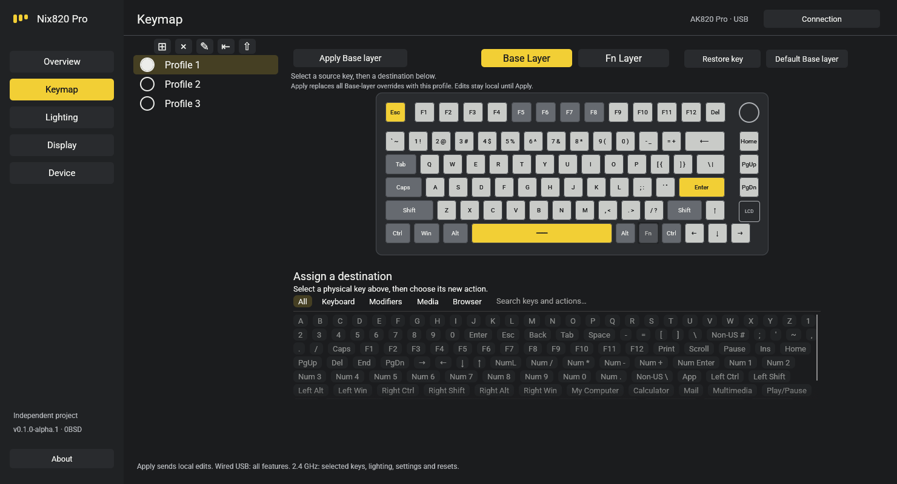
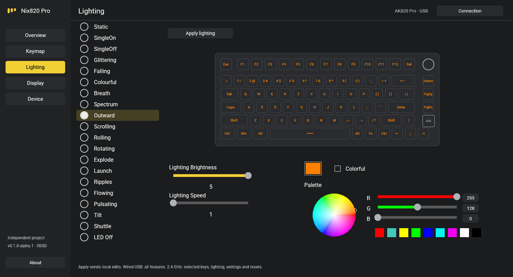

# Nix820 Pro

An independent **AJAZZ AK820 Pro configurator for Linux**, written in Rust with egui. Wired USB supports the full feature set; the 2.4 GHz receiver supports selected-key remapping, lighting, device settings and resets.

[Download v0.1.0-alpha.1](https://github.com/RobertMatosM/nix820-pro/releases/tag/v0.1.0-alpha.1) · [Installation and USB access](INSTALL.md) · [Report a problem](https://github.com/RobertMatosM/nix820-pro/issues)

This is an early prerelease. The project owner has tested wired and wireless operation; other hardware/firmware revisions and Linux distributions still need feedback. Nix or NixOS is not required.



## Install

Download the Linux x86_64 archive **and its `.sha256` file** from the release page, then run:

```sh
sha256sum -c nix820-pro-v0.1.0-alpha.1-linux-x86_64.tar.gz.sha256
tar -xzf nix820-pro-v0.1.0-alpha.1-linux-x86_64.tar.gz
cd nix820-pro-v0.1.0-alpha.1-linux-x86_64
bash install-user.sh
```

Open **Nix820 Pro** from your application menu, or run `~/.local/bin/nix820-pro`. If device access is denied, follow the [USB access instructions](INSTALL.md#usb-access). Run the GUI as your normal user.

Release binaries are built on **Ubuntu 24.04 x86_64** with glibc and use the system's X11/Wayland/OpenGL libraries. They are not standalone AppImages. See `BUILDINFO.txt` in the archive for the actual build environment; [build from source](INSTALL.md#build-from-source) if the binary is incompatible with your distribution.

## Use

1. Connect the keyboard by cable, or plug in its 2.4 GHz receiver and select that mode on the keyboard.
2. Open **Connection**, refresh devices and choose the wired keyboard or receiver.
3. Edit your settings, then click **Apply** or **Upload**. Changes stay local until sent. Resets require confirmation.

The editor shows local saved values; it does not read the keyboard's current configuration.

- **Keymap:** Base and Fn layers, keyboard/modifier/media/browser destinations and saved profiles. Wired **Apply layer** replaces the whole layer's overrides. Wireless **Apply selected key** changes one key.
- **Lighting:** twenty built-in modes, RGB/colorful, brightness and speed over cable or receiver.
- **Display:** wired-only images, GIF animation and clock sync, uploaded in the keyboard's 128×128 format.
- **Device:** response level, sleep time, shortcut locks, Reset Keyboard and Factory Reset over cable or receiver.



## Current limits

- Whole-layer defaults and factory Fn restoration require wired USB. On wireless Fn, **Use normal key** assigns the printed key explicitly; it does not restore a factory Fn shortcut.
- Fn reserves Esc, Backspace, Home, Win, Fn and Backslash/Pipe. The physical Fn source cannot be remapped on either layer.
- TFT transfers and clock sync are wired-only. Bluetooth configuration, macros, custom per-key lighting and audio-driven effects are not implemented.
- Applying a wired keymap replaces the selected layer's complete override table. Existing device overrides are not read or merged.
- A receiver acknowledgement alone does not establish that the keyboard is awake or in range. Transfers stop on errors without automatic retries; a reset or remap may already have taken effect when its acknowledgement is missing.

Profiles and display presets use XDG directories. Uninstall keeps them. See [saved data, migration and uninstall](INSTALL.md#saved-data-and-migration).

## Development

Use a recent stable Rust toolchain, Python 3.11+ and the native headers listed in [.github/workflows/ci.yml](.github/workflows/ci.yml).

```sh
cargo build --release --locked
./target/release/nix820-pro
bash scripts/check.sh
bash scripts/package.sh
```

The repository contains scoped configuration fixtures, not raw USB captures. `tests/wireshark/`, raw/compressed captures, personal app data and build outputs are ignored. Keep raw bus captures private: they can contain unrelated input and machine metadata. See [protocol evidence](https://github.com/RobertMatosM/nix820-pro/blob/main/docs/protocol.md), [wireless notes](https://github.com/RobertMatosM/nix820-pro/blob/main/docs/wireless-investigation.md) and the [release process](https://github.com/RobertMatosM/nix820-pro/blob/main/docs/release.md).

## License and independence

Original code, documentation and drawings are [0BSD](LICENSE). Fonts and dependencies retain their own licenses; see [THIRD_PARTY_NOTICES.md](THIRD_PARTY_NOTICES.md).

Not affiliated with or endorsed by AJAZZ. AJAZZ and AK820 Pro identify the supported keyboard. The interface, keyboard drawing and icon are independent project assets.
